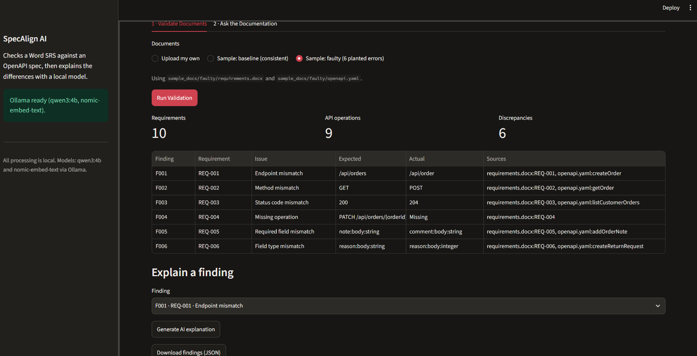

# SpecAlign AI

**SpecAlign AI checks whether two software documents agree with each other, and if they don't, it explains what's different and why it matters.**

It compares a requirements document (written in Word) with an API specification (written in YAML). Simple Python rules find the mismatches. A small AI model running on your own computer then explains each problem in plain language and answers your questions about the documents.



---

## Contents

1. [The problem](#1-the-problem)
2. [Key terms explained](#2-key-terms-explained)
3. [How SpecAlign AI works](#3-how-specalign-ai-works)
4. [Why I built it this way](#4-why-i-built-it-this-way)
5. [Installation](#5-installation)
6. [Using the app](#6-using-the-app)
7. [Results](#7-results)
8. [Limitations and next steps](#8-limitations-and-next-steps)
9. [About the sample data](#9-about-the-sample-data)
10. [Project structure](#10-project-structure)

---

## 1. The problem

When a team builds software, it usually writes the same plan down more than once. One document describes **what** the system should do. Another describes **exactly how** other programs should talk to it.

These documents are often written by different people at different times. They can slowly drift apart. Someone renames a web address in one document but forgets the other. Someone changes a field from text to a number. Nobody notices until two pieces of software are connected and fail to work together, which is the most expensive time to find out.

Checking for this by hand is slow. You read a requirement, find the matching part of the API spec, then compare the address, the action, the expected response, and every field, one by one. Then you do it again for the next requirement. It's repetitive work where small mistakes are easy to miss.

SpecAlign AI does that comparison automatically and then helps you understand what it found.

## 2. Key terms explained

If you're new to some of these terms, here's what they mean in this project.

**SRS (Software Requirements Specification).** A document that lists what a system must do, usually as numbered requirements. For example: *"REQ-001: The system shall allow customers to create an order."* In this project, the SRS is a Word file with a table, one row per requirement.

**API (Application Programming Interface).** The way one program talks to another. A web API is a set of web addresses that programs send requests to, like a menu of things you can ask a server to do.

**OpenAPI specification.** A standard way to describe a web API in a text file, usually written in YAML. It lists every address the API offers, what action each one accepts, what data it needs, and what it sends back. Developers build their code from this file, so it has to be correct.

**YAML.** A plain-text format for structured data that uses indentation instead of brackets. It's easy for both people and programs to read.

**Endpoint (or path).** A specific address in an API, such as `/api/orders`.

**HTTP method.** The action you're asking for at an endpoint. The common ones are `GET` (read something), `POST` (create something), `PATCH` (change part of something), and `DELETE` (remove something).

**Status code.** A three-digit number the server sends back to say how a request went. `200` means OK, `201` means something was created, `204` means it worked but there's nothing to return, and `404` means not found.

**Required field.** A piece of data that must be sent with a request. For example, creating an order requires a `customerId`. Each field has a **location** (in the address `path`, in the `query` string, or in the request `body`) and a **type** (such as `string` for text or `integer` for a whole number).

**Requirement ID.** A label like `REQ-004` that identifies one requirement. In the API spec, each operation is tagged with `x-requirement-id: REQ-004` so the tool knows which requirement it implements.

**LLM (Large Language Model).** An AI model that reads and writes text, like the models behind chatbots. This project uses **Qwen3:4B**, a small model with 4 billion parameters that runs on a normal laptop.

**Ollama.** A free program that runs AI models on your own computer instead of in the cloud. Nothing you load into SpecAlign AI is sent over the internet.

**Embedding.** A list of numbers that represents the meaning of a piece of text. Texts with similar meanings get similar numbers, which lets a program find related passages by comparing numbers. This project uses the **nomic-embed-text** model to make embeddings.

**RAG (Retrieval-Augmented Generation).** A way to make an AI answer questions about documents it has never seen. Before the model answers, the program *retrieves* the most relevant passages and gives them to the model along with the question. Think of it as an open-book exam: the model looks at the right pages instead of answering from memory.

**Chunk.** A small, self-contained piece of a document used for retrieval. Here, each requirement is one chunk and each API operation is one chunk.

**Cosine similarity.** A way to measure how close two embeddings are. A higher score means the two texts are more alike in meaning.

**False positive / precision / recall.** Ways to measure how accurate a checker is. A *false positive* is a problem that was reported but isn't real. *Precision* is the share of reported problems that are real. *Recall* is the share of real problems that were found. A perfect checker scores 1.00 on both.

## 3. How SpecAlign AI works

The tool works in three steps.

```
   Word SRS  +  OpenAPI YAML
             |
             v
   Step 1: Read both documents          (src/parsers.py)
             |
       +-----+------+
       |            |
       v            v
   Step 2:      Build a search index    (src/validator.py, src/rag.py)
   Compare      of both documents
   with rules
       |            |
       +-----+------+
             |
             v
   Step 3: Local AI explains and        (Qwen3:4B via Ollama)
           answers questions
             |
             v
   Streamlit web interface              (app.py)
```

### Step 1: Read both documents

The two documents look completely different. One is a Word table and the other is a YAML file. So the first job is to turn both into the same simple format, a list of records that each hold an ID, a method, a path, a status code, and the required fields.

The Word reader (`parse_requirements`) finds the requirements table and reads it row by row. In the SRS, required fields are written like `orderId:path:string`, meaning "a field called orderId, in the path, of type string."

The YAML reader (`parse_openapi`) walks through every endpoint and method in the API spec and collects the same information.

Every record also remembers which file it came from, so every problem the tool reports can point back to its source.

### Step 2: Compare the documents with rules

Each requirement is matched to the API operation with the same requirement ID. Then six checks run on every pair:

| Rule | What it checks | Example of a problem it catches |
| --- | --- | --- |
| V01 | Does the endpoint match? | SRS says `/api/orders`, API says `/api/order` |
| V02 | Does the HTTP method match? | SRS says `GET`, API says `POST` |
| V03 | Does the API include the expected success code? | SRS expects `200`, API only defines `204` |
| V04 | Does the requirement have an API operation at all? | Nothing in the API is tagged `REQ-004` |
| V05 | Are all required fields there, in the right place? | SRS requires `note`, API requires `comment` instead |
| V06 | Do the field types match? | SRS says `reason` is a string, API says integer |

Rule V03 only checks that the expected success code is present. An API is allowed to list extra error codes like `400` or `404`, so those are not reported as problems.

Every problem found becomes a **finding** with an ID, the requirement it belongs to, what was expected, what was actually found, and both sources. You can download the findings as a JSON file.

### Step 3: Let the local AI explain

Finding a mismatch is only half the job. A reviewer also needs to know what each document says and what could go wrong because of it. That's where the AI comes in.

1. Each requirement and each API operation is turned into a chunk of readable text.
2. Every chunk is converted into an embedding.
3. When you ask a question, it's converted into an embedding too, and the four closest chunks are found using cosine similarity.
4. Those chunks, plus any related findings from Step 2, are given to Qwen3:4B along with your question.
5. The model answers using only that evidence and lists the sources it used.

Two extra rules make retrieval more reliable:

- **If your question names a requirement ID** (like "Is the API consistent with REQ-001?"), the tool always includes *both* documents' chunks for that ID. Similarity search alone might only find one side, and you can't compare two things if you only see one.
- **If your question asks what's missing** (like "Which requirement has no API operation?"), the tool uses the full list of findings from Step 2. Search can't find something that isn't there, but the rules already know it's missing.

The model is also told to cite its sources, to describe both sides when documents disagree, not to decide which document is "right" (that's a judgment for an engineer), and to say so when the documents don't contain the answer.

## 4. Why I built it this way

**Why use rules to find problems instead of asking the AI?**
Checking whether `200` equals `204` is a yes-or-no question. Python answers it correctly every time, and I can write tests to prove it. An AI model can miss a difference, invent one that isn't there, or give a different answer if you ask twice. So the rules decide what's wrong, and the AI only explains it.

**Why use RAG at all?**
The model has never seen these documents. Without retrieval, it would have to guess. With RAG, it reads the exact passages before answering, so its explanation is based on the real text and can point to where that text came from.

**Why match requirements by ID instead of by endpoint?**
The endpoint is one of the things that might be wrong. If I matched on it, a typo like `/api/order` would look like a completely missing operation instead of a simple endpoint mismatch. Matching by requirement ID keeps the right pairs together so the real problem gets reported.

**Why a small model running locally?**
Engineering documents are often confidential. Running everything on your own machine means no text ever leaves it, and no API key or paid service is needed. The model's job is to explain evidence it's been given, not to solve hard problems on its own, so a small 4B model is enough.

**Why does validation still work without the AI?**
The rules don't depend on Ollama. If Ollama isn't running, the app still shows every finding and simply tells you how to start Ollama for the explanations.

## 5. Installation

You'll need:

- **Python 3.11 or 3.12**
- **Git**
- **Ollama**, from [ollama.com](https://ollama.com)

### Step 1: Download the project

```
git clone https://github.com/Aeldesouki/specalign-ai.git
cd specalign-ai
```

### Step 2: Create a virtual environment

A virtual environment keeps this project's Python packages separate from everything else on your computer.

**Windows (Command Prompt):**

```
py -3.11 -m venv .venv
.venv\Scripts\activate
```

**Windows (PowerShell):**

```
py -3.11 -m venv .venv
.venv\Scripts\Activate.ps1
```

**macOS / Linux:**

```
python3.11 -m venv .venv
source .venv/bin/activate
```

You'll know it worked when you see `(.venv)` at the start of your command line.

### Step 3: Install the Python packages

```
python -m pip install -r requirements.txt
```

### Step 4: Download the AI models

Install Ollama first. It runs in the background once it's installed. Then download the two models:

```
ollama pull qwen3:4b
ollama pull nomic-embed-text
```

Qwen3:4B is about 2.5 GB, so this may take a few minutes.

## 6. Using the app

Start the app:

```
streamlit run app.py
```

It opens in your web browser. The sidebar shows whether Ollama is ready.

### Tab 1: Validate Documents

1. Pick one of the sample datasets, or upload your own `.docx` requirements file and `.yaml` API file.
   - **Sample: baseline** has documents that agree. You should see 0 problems.
   - **Sample: faulty** has 6 mistakes planted on purpose. You should see all 6.
2. Click **Run Validation**. You'll see how many requirements and operations were found, and a table of every problem.
3. Pick a finding and click **Generate AI explanation** to see what each document says and why the difference matters.
4. Click **Download findings (JSON)** to save the results.

### Tab 2: Ask the Documentation

Type a question and click **Ask**. Some to try:

- *What does REQ-001 specify?*
- *Which endpoint retrieves an order?*
- *Is the API consistent with REQ-001?*
- *Which requirement has no corresponding API operation?*
- *What payment-processing API does the system support?* (The documents don't mention payments, so a good answer says the information isn't there.)

Under each answer, open **Retrieved evidence** to see exactly which passages the model was given and how closely each one matched your question.

### Running the tests

```
python -m pytest
```

The tests don't need Ollama. They check every rule, the document readers, and the retrieval logic.

### Measuring the results

```
python scripts/evaluate.py
```

This scores the validator against the list of planted mistakes, asks the AI five test questions, and writes everything to `reports/evaluation.md`. If Ollama isn't running, it still scores the validator and skips the AI part.

## 7. Results

The full report is in [`reports/evaluation.md`](reports/evaluation.md).

### Finding problems

On the **baseline** documents, which agree with each other, the validator found **0 problems**, which is correct.

On the **faulty** documents, which contain 6 planted mistakes, it found **all 6**, with **no false alarms** and **nothing missed**. That's a precision and recall of 1.00. A finding only counts as correct if both the requirement ID and the type of problem match the answer key.

The project has **36 automated tests**, and all of them pass.

### Answering questions

<!-- Fill this in from reports/evaluation.md after running scripts/evaluate.py with Ollama. -->

- Retrieved the right passages: **[X] of 4** in-scope questions
- Answers fully supported by the retrieved passages: **[X] of 5**
- Correctly said "not in the documents" for the payment question: **[Yes/No]**
- Average time per answer: **[X] seconds** on [your CPU / RAM / GPU]

## 8. Limitations and next steps

SpecAlign AI is a working prototype, so it has clear limits:

- It only reads Word files (with one requirements table) and OpenAPI YAML files.
- The Word table has to follow a set layout, and fields must be written as `fieldName:location:type`.
- It only handles simple API request formats. Nested data and shared definitions (`$ref`) aren't supported yet.
- It relies on every API operation being tagged with its requirement ID.
- It was tested on one small, made-up dataset. That shows the approach works, but not how accurate it would be on large real-world documents.
- AI explanations can still be wrong, so a person should always review them before acting on them.

Ideas for next steps:

- Support Excel, PowerPoint, and PDF documents
- Handle nested data and `$ref` definitions
- Match requirements to operations by name when IDs are missing
- Test on a larger set of documents with more kinds of mistakes
- Let reviewers accept or reject findings, and turn their decisions into new test cases

## 9. About the sample data

All the documents in `sample_docs/` are **made up**. They describe an imaginary online ordering system and contain no real or private information. I generated them with Claude for this project. The prompts and steps I used are in [`data_generation/claude_prompts.md`](data_generation/claude_prompts.md).

The 6 mistakes in the faulty dataset were added by a Python script (`data_generation/make_faulty.py`), not by an AI, so that exactly those 6 things changed and nothing else. The list of planted mistakes is in `ground_truth.json`. It's only used to score the results and is never shown to the AI.

The app itself only uses AI models running locally through Ollama. It doesn't use any cloud AI service, so you don't need an API key. Please don't upload confidential documents to a public repository.

## 10. Project structure

```
specalign-ai/
├── app.py                    The Streamlit web interface
├── requirements.txt          Python packages to install
├── src/
│   ├── parsers.py            Reads the Word SRS and the OpenAPI YAML
│   ├── validator.py          The six comparison rules and scoring
│   └── rag.py                Chunks, embeddings, search, and AI answers
├── sample_docs/
│   ├── baseline/             Documents that agree
│   └── faulty/               Same SRS, API spec with 6 planted mistakes
├── data_generation/          Scripts and prompts used to make the samples
├── ground_truth.json         The answer key for the 6 planted mistakes
├── tests/                    Automated tests (pytest)
├── scripts/evaluate.py       Measures results and writes the report
├── reports/evaluation.md     The latest results
└── screenshots/              Images used in this README
```
